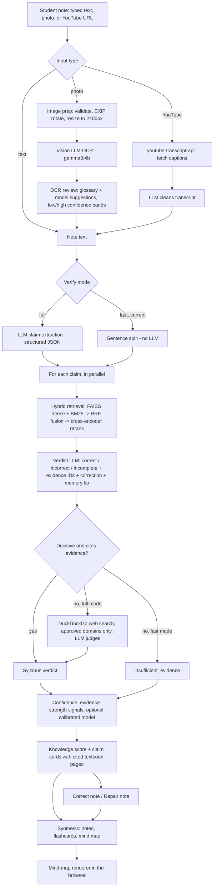

# Knowledge Maps (Member 4) — flow, models, and model history

Knowledge Maps checks a student's own science notes against the syllabus textbooks, fixes the mistakes, and turns the result into study material: structured notes, flashcards and a mind map. It also accepts photos of handwritten notes (OCR) and YouTube videos.

* UI: `frontend/knowledge_maps/` (two tabs: **Verify Notes** and **Synthesis**)
* API: `backend/components/knowledge_maps/`, under `/api/m4/*`. Some short aliases like `/api/verify` exist for the frontend.
* Shared textbook index: the same FAISS index Voice Tutor uses (`backend/common/vector_store.py`)

---

## 1. Features and endpoints

| Feature | Endpoint | What it does |
|---|---|---|
| Health | `GET /api/m4/health` | Is the LLM reachable? Returns the model name and ping latency |
| OCR | `POST /api/m4/upload-ocr` | Photo of handwritten/printed notes → text (vision LLM) |
| OCR review | `POST /api/m4/ocr-review` | OCR text + uncertain spans + suggested corrections (glossary + model) |
| Verify | `POST /api/m4/verify` | Splits notes into claims, checks each against the syllabus, scores the note |
| Correct note | `POST /api/m4/correct-note` | Verify → keep only correct claims → rewrite a clean note |
| Repair note | `POST /api/m4/repair-note` | Fix cited mistakes in place, re-verify the fixes, keep the original structure |
| Synthesize | `POST /api/m4/synthesize` | `notes` / `flashcards` / `mindmap` from text |
| YouTube analyse | `POST /api/m4/youtube` | Transcript → verify → notes + flashcards + mind map |
| Video summary | `POST /api/m4/video-summary` | Transcript → short study summary (no verification) |
| YouTube suggest | `POST /api/m4/youtube-suggest` | Search videos for a topic (YouTube Data API) |
| Curriculum PDF | `GET /api/m4/documents/{id}` | Opens the cited textbook page from an evidence card |

---

## 2. End-to-end flow



### Step by step

1. **Input**
   * **Typed text** goes straight to verification.
   * **Photo** (`ocr.py`, `ocr_image.py`): Pillow validates the image, fixes the rotation and limits the longest side to 2400 px. A **vision LLM** then transcribes it.
     * `ocr_review.py` / `ocr_recovery.py` flag uncertain words. The confidence bands are 0.65 / 0.85. Corrections come from an optional science glossary plus model suggestions, and the student accepts or rejects each one.
   * **YouTube** (`youtube.py`): `youtube-transcript-api` fetches captions, and the LLM cleans them (temperature 0.1).

2. **Claim extraction** (`verification.py`)
   * **Full mode:** the LLM extracts atomic factual claims as structured JSON.
   * **Fast mode (current):** the text is split into sentences with a regex. There's no LLM call, and a sentence needs at least 3 words to count as a claim.

3. **Hybrid retrieval, per claim** (`hybrid_retrieval.py`)
   * **Dense search:** FAISS over textbook chunks embedded with `all-MiniLM-L6-v2`. Top 20.
   * **Keyword search:** BM25 (`rank_bm25`) over the same chunks. Top 20. It catches exact science terms that embeddings miss.
   * **Query glossary (optional):** expands synonyms and alternative terms before searching.
   * **Reciprocal Rank Fusion** (`k = 60`) merges the two rankings, keeping the top 8.
   * A **cross-encoder reranker** rescores those 8 claim–passage pairs and keeps the top 5. Then 3 go to the verdict model (2 in fast mode).

4. **Verdict** (`verification.py`, `prompts.py`)
   * The LLM returns one of `correct` / `incorrect` / `incomplete`.
   * It also returns the **IDs of the evidence passages it used**, an explanation, a corrected version and a memory tip.
   * A verdict only counts if it cites valid evidence IDs (`evidence.py`). That's evidence gating: no citation, no verdict.

5. **Web fallback** (`web_search.py`, full mode only)
   * If the syllabus didn't give a decisive, cited answer, the system runs a DuckDuckGo search.
   * Results are filtered to `M4_WEB_ALLOWED_DOMAINS`, and the LLM judges them at temperature 0.
   * Anything still undecided becomes `insufficient_evidence` and is **excluded from the score**.

6. **Confidence** (`confidence.py`)
   * It uses transparent signals:
     * top retrieval score and the gap to the second
     * number and mean score of the cited passages
     * source (syllabus or web), number of web domains
     * the verdict
   * An optional offline-calibrated model can be plugged in (`M4_CONFIDENCE_MODEL_PATH`); none is set, so the transparent strength score is used.

7. **Output**
   * An overall knowledge score from 0 to 1.
   * Claim cards with the verdict, the correction, and a link to the cited textbook PDF page.

8. **Repair / correct** (`repair_note.py`, `correct_note.py`)
   * *Correct note* rewrites a clean note using only the claims marked correct.
   * *Repair note* fixes only the cited mistakes, **re-verifies each fix**, and keeps the student's headings and bullets.

9. **Synthesis** (`synthesis.py`)
   * The LLM produces notes, flashcards, or a mind map via tool / JSON-schema output.
   * For the mind map, the code normalises node IDs, repairs broken edges, and forces a single connected tree.
   * The browser renders it with `mindmap-model.js` and `mindmap-render.js`.

**Engineering details**
- Claims are verified in parallel; the worker count is `M4_VERIFY_MAX_WORKERS`.
- Verdict and claim results are cached in an LRU cache, keyed by the text plus a **retriever signature**. That signature is a hash of the retrieval settings, the reranker and the glossary, so changing any of them invalidates the cache.
- `llm_client.py` asks for structured output in this order: tool call, then JSON-schema mode, then JSON mode, then parsing JSON out of plain text. This works across Ollama and Azure.

---

## 3. Models used now

Configured in `.env` (defaults in `backend/common/config.py`):

| Role | Model | Setting | Where it runs |
|---|---|---|---|
| Main LLM: OCR (vision), claim extraction, synthesis, repair, transcript cleaning, web judging | **`gemma3:4b`** (Ollama, 4-bit, ~3.4 GB, supports images) | `M4_LLM_PROVIDER=ollama`, `M4_OLLAMA_MODEL=gemma3:4b` | Local GPU |
| Verdict model (fast verify) | **`qwen2.5:3b`** (Ollama, ~1.9 GB) | `M4_VERIFY_FAST=1`, `M4_VERIFY_MODEL=qwen2.5:3b` | Local GPU |
| Embeddings (dense retrieval) | **`sentence-transformers/all-MiniLM-L6-v2`** (22M params, 384-dim) | `EMBEDDING_PROVIDER=local`, `EMBEDDING_MODEL` | Local CPU |
| Keyword retrieval | **BM25 Okapi** (`rank_bm25`) | `M4_HYBRID_BM25_K=20` | Local CPU |
| Reranker | **`cross-encoder/ms-marco-MiniLM-L6-v2`** (22M params) | `M4_RERANKER_MODEL` | Local CPU |
| Web search | DuckDuckGo (`duckduckgo_search`) | `M4_WEB_SEARCH_TIMEOUT_SECONDS=8` (unused in fast mode) | Internet |
| Transcripts / video search | `youtube-transcript-api`, YouTube Data API v3 | `YOUTUBE_API_KEY` | Internet |
| Confidence | Rule-based evidence-strength score (no trained model loaded) | `M4_CONFIDENCE_MODEL_PATH=` (empty) | Local |

Retrieval parameters: dense 20, BM25 20, fused 8, final 5, RRF k 60. The verdict model sees the top 3 passages (2 in fast mode). 4 parallel workers.

Generation temperatures:
* Verdicts and claim extraction: 0.1 (`chat_with_tools` default)
* OCR and web judging: 0.0
* Transcript cleaning: 0.1
* Video summary: 0.3

---

## 4. Previous models → current, and why they changed

| Role | Original (Aug 30, `0f9c776`, Dilshan) | Now (Oct 19) | Why it changed |
|---|---|---|---|
| Main LLM | **`gemma4:cloud`** (Ollama cloud, ~33B, needs internet + sign-in) | **`gemma3:4b`** (local) | Works offline, no cloud account or quota, and student notes stay on the machine. Still supports images, so OCR keeps working. |
| Cloud fallback | **Azure OpenAI `gpt-4o`** (`M4_LLM_PROVIDER=azure`) | Still available, not active (Azure keys are placeholders) | Paid and needs keys; kept for research comparisons. Oct 5 (`ae33d19`) added Azure AI Foundry endpoint support and model-name aliases (`gemma:cloud` → `gemma4:cloud`). |
| Verify pipeline | **Full mode:** LLM claim extraction → verdict by the main model → web fallback, 5 workers | **Fast mode** (`87dca5c`, Oct 19): sentence split → verdict by `qwen2.5:3b` → no web fallback, 4 workers, top-2 passages | On a 4 GB laptop GPU, a 4B model with 5 parallel calls spilled to CPU and verify took minutes. `qwen2.5:3b` fits fully on the GPU alongside the main model, and skipping the extraction call removes one full LLM round-trip. |
| Reranker | **`BAAI/bge-reranker-v2-m3`** (568M params, multilingual) | **`cross-encoder/ms-marco-MiniLM-L6-v2`** (22M) | bge-v2-m3 measured ~2 s per passage on CPU (8 passages × every claim). The MiniLM cross-encoder is ~25× smaller and fast enough to run per claim. Trade-off: weaker on non-English text. The reranker was also pinned to CPU (`87dca5c`) to avoid crashes from parallel threads on Apple GPUs. |
| Embeddings | `all-MiniLM-L6-v2` | `all-MiniLM-L6-v2` (unchanged) | Shared with Voice Tutor's FAISS index; changing it means re-ingesting all textbooks. |
| Ollama general chat default | `mistral` | `llama3.1` default (`.env` uses `qwen2.5:0.5b`) | Other components; Knowledge Maps uses `M4_OLLAMA_MODEL`. |

### What fast mode gives up (say this in the presentation)

* **Sentence split vs LLM extraction.** A sentence with two facts is checked as one claim, and a fact spread over two sentences may be missed.
* **No web fallback.** Claims the syllabus can't decide become `insufficient_evidence` rather than being checked online. That is safer for a syllabus-focused tool, but covers less.
* **Smaller verdict model.** It sees 2 passages instead of 3, so verdicts can be less reliable on borderline claims.

To switch back to the original quality on a bigger GPU or with internet, set `M4_VERIFY_FAST=0` and, optionally, `M4_OLLAMA_MODEL=gemma4:cloud` and `M4_RERANKER_MODEL=BAAI/bge-reranker-v2-m3`.

---

## 5. Why these model choices (for the panel)

* **Hybrid retrieval, not just embeddings.** Science notes are full of exact terms ("ohm", "chlorophyll a", "Newton's second law"). BM25 matches them exactly, embeddings match paraphrases, and RRF combines both without tuning weights.
* **A reranker on top.** The cross-encoder reads the claim and passage *together*, which is much more accurate than comparing two embeddings. It runs only on the fused top 8, so cost stays small.
* **Evidence gating.** The model must cite passage IDs, or its verdict doesn't count. This turns hallucination into an `insufficient_evidence` result instead of a wrong answer.
* **Two LLM sizes.**
  * `gemma3:4b` does the language-heavy work (OCR, synthesis, rewriting).
  * `qwen2.5:3b` does the many short, structured verdict calls, which need speed and parallelism more than writing quality.
* **Local first.** Student notes from minors stay on the device, it works without internet in schools, and there's no per-request cost. Azure / cloud are switchable fallbacks.

---

## 6. Key configuration (`.env`)

```env
M4_LLM_PROVIDER=ollama
M4_OLLAMA_MODEL=gemma3:4b
M4_VERIFY_FAST=1
M4_VERIFY_MODEL=qwen2.5:3b
M4_VERIFY_MAX_WORKERS=4
EMBEDDING_PROVIDER=local
EMBEDDING_MODEL=sentence-transformers/all-MiniLM-L6-v2
M4_RERANKER_MODEL=cross-encoder/ms-marco-MiniLM-L6-v2
M4_HYBRID_DENSE_K=20
M4_HYBRID_BM25_K=20
M4_HYBRID_FUSED_K=8
M4_HYBRID_FINAL_K=5
M4_RRF_K=60
M4_OCR_MAX_DIMENSION=2400
M4_OCR_CONFIDENCE_LOW=0.65
M4_OCR_CONFIDENCE_HIGH=0.85
M4_WEB_ALLOWED_DOMAINS=
M4_CONFIDENCE_MODEL_PATH=
```

For a 4 GB GPU, also set `OLLAMA_NUM_PARALLEL=2` for the Ollama server (from `.env.example`).

## 7. File map

| File | Responsibility |
|---|---|
| `router.py` | Endpoints, error mapping (400/422/501/502/503), health |
| `llm_client.py` | Ollama / Azure client, tool → JSON-schema → JSON fallback, vision calls, per-call model override |
| `prompts.py` | All prompts (OCR, claim extraction, verdict, synthesis, repair) |
| `verification.py` | Claim extraction, per-claim verdicts, web fallback, caching, fast mode |
| `hybrid_retrieval.py` | FAISS + BM25 + RRF + cross-encoder reranker, query glossary, retriever signature |
| `evidence.py` | Evidence-ID validation, curriculum PDF allowlist |
| `confidence.py` | Evidence-strength signals, optional calibrated confidence model |
| `web_search.py` | DuckDuckGo search, domain allowlist, LLM judgement |
| `ocr.py`, `ocr_image.py`, `ocr_review.py`, `ocr_recovery.py` | Image prep, vision OCR, uncertainty review, glossary suggestions |
| `correct_note.py`, `repair_note.py` | Clean rewrite / structure-preserving repair with re-verification |
| `synthesis.py` | Notes, flashcards, mind map + graph repair |
| `youtube.py`, `youtube_suggest.py` | Transcripts, video analysis and summary, video search |
| `concurrency.py` | Bounded parallel workers |
