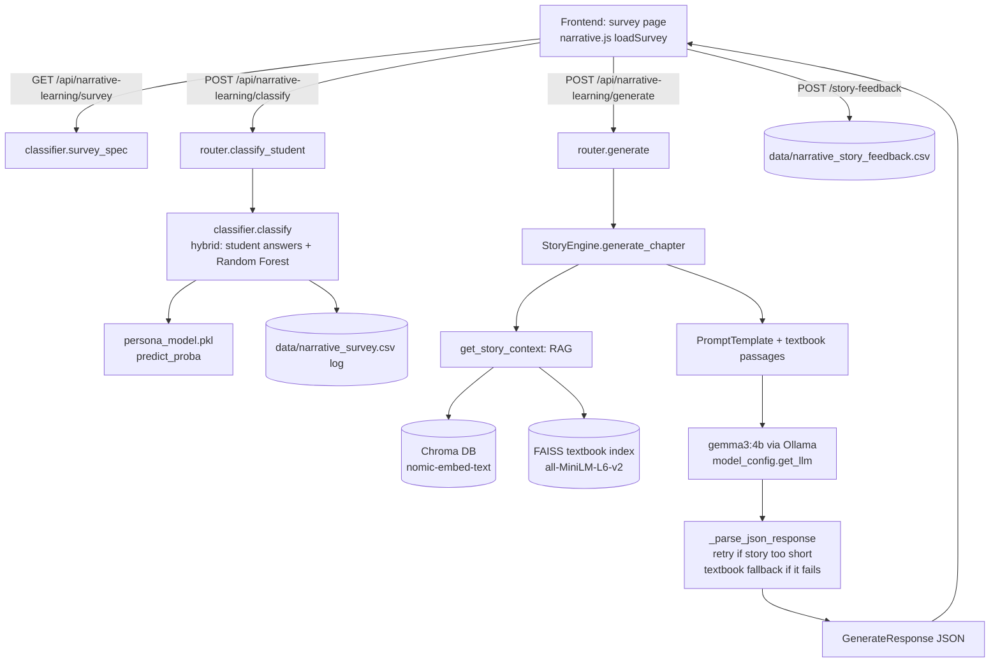

# Narrative Learning — viva guide ("where is it in the code?")

Use this when the panel asks *"show me where you…"*. Every answer gives the **file**, the **function**, and the **line number**. Paths are from the repo root. Line numbers are correct as of 2026-10-20; if code moves, search for the function name.

For **why** decisions were made (model choice, parameters, comparisons), see `docs/narrative_learning_defense.md`. This guide is about **where** and **how**.

---

## 0. The 30-second explanation

> A Grade 10–11 student answers 6 survey questions. A **Random Forest classifier** plus the student's own answers picks one of 5 **story themes**. The backend then **retrieves real textbook passages** for the chosen chapter (RAG), puts them into a **prompt**, and the local LLM **gemma3:4b (via Ollama)** writes a lesson as JSON: an explanation, a 3-paragraph Sri Lankan story, key terms, equations, exam points and one quick-check question. The frontend renders it. The student's rating and quick-check answer are logged for evaluation. To improve the writer, we **distilled** lessons from a 33B teacher model and prepared **QLoRA fine-tuning** of the 4B model.

---

## 1. Map: where everything lives

| What | Where |
|---|---|
| **Backend component** | `backend/components/narrative_learning/` |
| API endpoints (FastAPI router) | `backend/components/narrative_learning/router.py` |
| Classifier at run time (hybrid decision, logging) | `backend/components/narrative_learning/classifier.py` |
| **Trained classifier model** | `backend/components/narrative_learning/persona_model.pkl` (scikit-learn pipeline) |
| Model metadata + metrics | `backend/components/narrative_learning/persona_model.json` |
| Story generation (RAG + prompt + LLM call) | `backend/components/narrative_learning/story_engine.py` |
| LLM + embedding model setup | `backend/components/narrative_learning/model_config.py` |
| Request / response formats | `backend/components/narrative_learning/schemas.py` |
| Syllabus chapter list | `backend/components/narrative_learning/syllabus_data.py` |
| Where the router is plugged into the app | `backend/main.py` line 26 (import), line 161 (`include_router` with `/api` prefix), lines 198–201 (serves the page) |
| **Classifier training code** | `scripts/train_persona.py` |
| **Training data: synthetic** | `scripts/sri_lankan_student.csv` (73 rows, 64 used) |
| **Training data: real survey** | `data/narrative/rp_survey_responses.xlsx` (26 usable answers; git-ignored, student data) |
| Cleaned rows actually used to train | `data/narrative/training_rows.csv` (written by `train_persona.py`) |
| Classifier testing code | `scripts/compare_persona_classifiers.py`, `scripts/persona_classifier_metrics.py` |
| **Fine-tuning dataset builder** (distillation) | `scripts/build_finetune_dataset.py` |
| **Fine-tuning training code** (QLoRA) | `notebooks/narrative_qlora_unsloth.ipynb` |
| Loading the fine-tuned model into Ollama | `scripts/narrative_lora.Modelfile` |
| Fine-tuning data | `data/finetune/train.jsonl` (112), `test.jsonl` (26), `review.csv` (git-ignored) |
| Story-model comparison code | `scripts/compare_story_models.py` |
| Test results + copies of the test code | `reports/classification/`, `reports/narrative/`, `reports/system_performance/` |
| Frontend (one page) | `frontend/narrative_learning/index.html`, `narrative.js`, `narrative.css` |
| Settings | `.env` → `LLM_PROVIDER=ollama`, `OLLAMA_LLM_MODEL=gemma3:4b`, `OLLAMA_EMBED_MODEL=nomic-embed-text` |

---

## 2. End-to-end flow (what happens when a student clicks "Generate")



Step by step, with file and line numbers:

| Step | What happens | Where |
|---|---|---|
| 1 | Page loads the 6 survey questions | `narrative.js` `loadSurvey()` line 74 → `router.py` `survey()` line 61 → `classifier.py` `survey_spec()` line 60 |
| 2 | Page loads the chapter list | `narrative.js` `loadChapters()` line 85 → `router.py` `chapters()` line 92 → `syllabus_data.py` `CHAPTER_MAP` |
| 3 | Student submits answers → theme | `narrative.js` `classifyStudent()` line 391 → `router.py` `classify_student()` line 66 → `classifier.py` `classify()` line 212 |
| 4 | Student picks a chapter → generate | `narrative.js` `generateStory()` line 439 → `router.py` `generate()` line 97 |
| 5 | Story engine created once (lazy) | `router.py` `_get_engine()` line 35 → `story_engine.py` `StoryEngine.__init__` line 192 |
| 6 | Textbook passages retrieved (RAG) | `story_engine.py` `get_story_context()` line 220 |
| 7 | Prompt filled and sent to the LLM | `story_engine.py` `generate_chapter()` line 290; prompt lines 310–372; call at line 379 |
| 8 | JSON parsed, checked, retried, or fallback | `story_engine.py` lines 377–419 |
| 9 | Response returned to the page | `router.py` lines 139–151 (`GenerateResponse`) |
| 10 | Page renders terms, story, quick-check | `narrative.js` `highlightTerms()` line 120, `normalizeCheck()` 181, `renderCheck()` 253 |
| 11 | Rating + quick-check result logged | `narrative.js` `sendStoryFeedback()` line 225 → `router.py` `story_feedback()` line 78 → `classifier.py` `log_story_feedback()` line 312 |

---

## 3. The classifier

### 3.1 Where is the training data?

* **Synthetic:** `scripts/sri_lankan_student.csv`. Columns: `Student_ID, Grade, Interest, Aspiration, Struggle_Level, Story_Theme`. 73 rows; 9 with "Other" answers are dropped, leaving **64**. They were generated from the real survey patterns to cover every interest and career goal.
* **Real:** `data/narrative/rp_survey_responses.xlsx`, the Google Form export. 28 responses, 2 unusable, leaving **26**. Git-ignored because it is student data.
* **Combined, cleaned rows:** `data/narrative/training_rows.csv` (90 rows). This is exactly what the model trains on.

### 3.2 Where is the training code? (`scripts/train_persona.py`)

| Part | Line | What it does |
|---|---|---|
| `FEATURES` | 35 | Inputs: `Interest`, `Aspiration`, `Struggle_Level` |
| `_rf()` | 39 | **The deployed model:** `RandomForestClassifier(n_estimators=200, max_depth=5, min_samples_leaf=2, class_weight="balanced", random_state=42)` |
| `candidate_models()` | 44 | All 8 models compared. Each is a pipeline: `OneHotEncoder` → model |
| `INTEREST_CANON`, `ASPIRATION_CANON`, `THEME_FROM_STYLE`, `STRUGGLE_MAP` | 74, 106, 128, 152 | Clean free-text answers into fixed categories (e.g. "PUBG" → `Gaming`) |
| `canonicalize_frame()` | 210 | Applies the cleaning; drops "Other" |
| `load_base()` | 236 | Loads the synthetic CSV |
| `load_survey()` | 247 | Loads the Google Form. Finds columns by keywords (line 253–257). The **label** is the "which story style" answer (lines 269–277) |
| `main()` | 305 | Combines both datasets (329, 333), saves cleaned rows (343) |
| Evaluation before saving | 363, 368 | Real-student test (protocol C) + full-dataset 5-fold cross-validation |
| **Weighting** | 384 | Real survey rows weight 3, synthetic rows weight 1 |
| **Training** | 385 | `fit_weighted(...)` → `pipeline.fit(X, y, sample_weight=...)` (function at 410) |
| **Saving** | 391, 403 | `pickle.dump` → `persona_model.pkl`; metadata + metrics → `persona_model.json` |
| `evaluate_on_survey()` | 424 | Test protocols A / B / C on real students |

**Retrain command:** `.venv\Scripts\python.exe scripts/train_persona.py --model "Random Forest (one-hot)"`

### 3.3 Where is the classifier used in the app? (`backend/components/narrative_learning/classifier.py`)

| Part | Line | What it does |
|---|---|---|
| `THEMES` | 27 | The 5 output classes |
| `STYLE_TO_THEME` | 41 | Maps the student's style answer (`action`, `creative`, …) to a theme |
| `USE_TRAINED` | 37 | On by default; `USE_TRAINED_CLASSIFIER=0` in `.env` turns the model off |
| `_load_model()` | 160 | Loads `persona_model.pkl` once (`@lru_cache`), checks the format in `persona_model.json` |
| `predict_theme()` | 193 | Builds a one-row DataFrame → `model.predict_proba()` → best theme + confidence |
| **`classify()`** | 212 | **The hybrid decision** (lines 221–233): |
| | 221–224 | Style and opening answers **disagree** → the model picks whichever of the two it rates higher (`model-tiebreak`) |
| | 225–227 | Answers **agree**, or only one is given → the student's choice (`student-choice`) |
| | 228–230 | **No style answers** → the model's prediction (`model`) |
| | 231–233 | **No model** → default theme |
| `_append_survey_log()` | 259 | Every classification is logged with the model's prediction to `data/narrative_survey.csv` |
| `model_live_accuracy()` | 292 | How often the model agrees with real students in the app (shown in `/status`) |

**Why hybrid?** The model scores 80.3% accuracy and 78.0% F1 on the full dataset. On real students alone, the correct theme is in its top 2 picks 74% of the time. So it is reliable for breaking ties, but should not override a student who has clearly told us what they want.

### 3.4 How does the theme reach the story?

`router.py` `generate()` line 107–119 gets the theme (from the classifier or from the page), then passes it as `student_theme` into `generate_chapter()` (line 121). Inside the prompt it appears as `Theme: {theme}` (`story_engine.py` line 316). The student's interest, career goal and struggle level also go into the prompt (line 317) and shape the story.

---

## 4. Retrieval (RAG): how the textbook gets into the story

**Function:** `story_engine.py` `get_story_context()` line 220. It uses two sources:

1. **Chroma vector DB** (`backend/components/narrative_learning/science_vector_db/`, git-ignored)
   * Embeddings: **`nomic-embed-text`** through Ollama (`model_config.py` `get_embeddings()` line 44).
   * Path chosen by `_resolve_vector_db()` (`model_config.py` line 11).
   * Search: `similarity_search_with_score(topic, k=10)` (line 229). Optionally filtered by textbook (`BOOK_FILENAME_MAP`, line 184).
   * Filtering, lines 233–253:
     * keep passages with ≥ 55% similarity (after the first 2)
     * keep at most 4 passages, 700 characters each
     * drop page headers or page numbers (`_passage_is_usable()`, line 81)
2. **Shared FAISS textbook index**, the same one Voice Tutor and Knowledge Maps use (`data/science_index.faiss`, 1,062 chunks from the Grade 10–11 textbooks and teacher's guides).
   * Function: `_faiss_syllabus()` line 102 → `backend/common/retrieval.py` `retrieve()` → embeddings `all-MiniLM-L6-v2`. Fetches top 6, keeps up to 4.
   * Built by `scripts/ingest.py` from the PDFs in `Resource/`; loaded at server start-up (`backend/main.py` `lifespan`, line 51).
   * Merged with the Chroma passages at lines 255–265.

The combined text is cut to **3,200 characters** (`_trim_context()`, line 95), then inserted into the prompt as `{context}` (line 319). The sources (file, page, similarity) are returned to the page so the student sees **which textbook page** the lesson came from.

**Be ready to say:** the Chroma DB came from our earlier prototype and is small, mostly page headers. That is why we added the FAISS index, which is where most of the real textbook text comes from. Comment at line 103: *"Chroma often only has headers"*.

---

## 5. The LLM: where it is and how it is connected

**Setup:** `model_config.py` `get_llm()` line 54. The default path (Ollama) is at lines 94–102:

```python
ChatOllama(
    model=OLLAMA_LLM_MODEL,      # gemma3:4b from .env
    temperature=0.65,
    format="json",               # forces JSON output
    base_url=OLLAMA_BASE_URL,    # http://127.0.0.1:11434 (local Ollama server)
    keep_alive=-1,               # stays loaded in memory
    num_ctx=6144,                # context window
    num_predict=1800,            # max output tokens
)
```

* **Library:** LangChain (`langchain_ollama.ChatOllama`). Ollama runs the model locally on the laptop.
* **Model name** comes from `.env` → `OLLAMA_LLM_MODEL=gemma3:4b` (read at `model_config.py` line 26).
* **Switching provider:** set `LLM_PROVIDER` in `.env`. Options are `ollama` (default, local), `groq` (cloud, lines 55–72, temperature 0.4) or `openrouter` (lines 74–90).
* **Which model wrote a story:** `active_model_name()` line 36. It is returned in every response and logged with feedback.
* **Created once:** `StoryEngine.__init__` line 213, `self.llm = get_llm()`, plus a warm-up call at lines 214–218 so the first student doesn't wait for the model to load.
* **Called:** `story_engine.py` line 379: `(prompt | self.llm).invoke({...})`. This is a LangChain chain, meaning prompt template → LLM.

---

## 6. The prompt

**Where:** `story_engine.py` lines 310–372 (`PromptTemplate` in `generate_chapter()`).

**Variables filled in** (line 311): `theme, topic, diagnostic, context, interest, aspiration, struggle_level, length_nudge`.

| Prompt section | Lines | Purpose |
|---|---|---|
| Role + student profile | 313–317 | "You are a science teacher… Sri Lankan Grade 10-11 student", plus the topic, the student's struggle, the theme, interest, career and struggle level |
| **Grounding rule** | 318–319 | "Use ONLY these textbook passages. Do not invent syllabus facts:" followed by `{context}` |
| Retry nudge | 320 | Empty normally; filled on the retry (see section 7) |
| TELL vs SHOW | 322–328 | `science_intro` = classroom explanation, no characters; simpler if struggle is High |
| Story rules | 330–334 | Real scene, Sri Lankan name, **exactly 3 paragraphs** (hook → action → bridge to the textbook law), 220+ words |
| Rules | 336–341 | Link to the interest; no sci-fi gadgets or "Imagine you are…"; one `check_question`; 2–4 `key_definitions` that appear word-for-word in the story; JSON only |
| JSON template | 343–370 | Exact output shape, with `story` **last** |

Two design decisions found by testing:

* **`story` is the last field.** gemma3:4b used to stop after a long story and drop every later field. Putting the short fields first made output 100% complete.
* **`<...>` placeholders in `check_question`** (line 363). With a concrete example the model copied it word for word. The frontend also rejects any option still containing `<...>` (`narrative.js` `normalizeCheck()` line 181).

There is a second, older prompt, `generate_question()` (line 269). It is **not used** by the app; the quick-check question now comes from the main prompt.

---

## 7. Output handling: parse, retry, fallback (`story_engine.py`)

| Part | Line | What it does |
|---|---|---|
| `_parse_json_response()` | 43 | Strips `<think>` tags and markdown fences, then finds the first valid JSON object containing `story` or `science_intro` |
| Loop of 2 attempts | 377 | |
| Unparseable output → try again | 387–391 | |
| **Story too short → retry** | 394–405 | `_story_is_thin()` (line 136): under 160 words or not 3 paragraphs. The retry adds the `length_nudge` text: "PREVIOUS OUTPUT WAS TOO SHORT…" |
| Context too long (Groq) → shorten | 412–413 | Cuts the context to 1,600 characters |
| **Textbook fallback** | 419 → `_fallback_chapter()` line 146 | If the LLM fails completely, the student still gets the real textbook text, so there is never an empty page or an invented story |

---

## 8. Fine-tuning: where and how

### 8.1 Dataset: knowledge distillation (`scripts/build_finetune_dataset.py`)

| Part | Line | What it does |
|---|---|---|
| `make_teacher()` | 67 | Teacher model: `gemma4:cloud` (~33B) via Ollama by default (line 125), or Groq. Temperature 0.6 |
| **Recording the exact prompt** | 159–163 | `RunnableLambda(recording_teacher)` replaces `engine.llm`, so the **real app pipeline** (same retrieval, same prompt) runs with the teacher, and the exact prompt text is saved |
| Train/test split **by chapter** | 139–146 | 20% of chapters held out; written to `data/finetune/test_topics.txt` |
| Random student profiles | 182–187 | Interest, career, struggle and diagnostic, drawn from the real survey options |
| Calls the real engine | 191 | `engine.generate_chapter(...)` |
| **Quality gates** | 86 (`quality_gate()`) | Rejects: missing fields, textbook fallback, thin story, bad quick-check, definition terms not in the story |
| Saved sample | 204–213 | Chat format `{"messages": [user = prompt, assistant = JSON lesson], "meta": {...}}` → `data/finetune/train.jsonl` / `test.jsonl` |
| Teacher review sheet | 215–221 | `data/finetune/review.csv`. Teachers mark `approved` yes/no; `--apply-review` (line 106) removes rejected rows |

**Result:** 138 samples kept (112 train / 26 test), 2 rejected. The 7 test chapters never appear in training.

### 8.2 Training: QLoRA (`notebooks/narrative_qlora_unsloth.ipynb`, run on Google Colab with a T4 GPU)

| Cell | What it does |
|---|---|
| 1 | Explains the method: distillation + QLoRA, and why not full fine-tuning |
| 2 | `pip install unsloth`, check the GPU |
| 4 | Upload `train.jsonl` / `test.jsonl` |
| 5–6 | Load `unsloth/gemma-3-4b-it` **in 4-bit** (`load_in_4bit=True`, the "Q" in QLoRA); add LoRA adapters: `r=16`, `lora_alpha=16`, attention + MLP layers |
| 7 | Apply the Gemma chat template to the samples |
| 8–9 | `SFTTrainer`: learning rate 2e-4, batch 2 × gradient accumulation 4, 2 epochs, `adamw_8bit`, weight decay 0.01, `train_on_responses_only` (loss only on the JSON answer), evaluate on the held-out chapters |
| 10 | Train / eval loss curve → `loss_curve.png` |
| 12 | Quick JSON-validity check on test prompts |
| 14 | Save the LoRA adapter + export a **GGUF** (q4_k_m) for Ollama |
| 15 | How to load it in the app |

### 8.3 Deployment

`scripts/narrative_lora.Modelfile` points Ollama at the GGUF file, with the Gemma chat template and the same parameters (temperature 0.65, num_ctx 6144).

```powershell
ollama create narrative-gemma3 -f scripts/narrative_lora.Modelfile
# .env: OLLAMA_LLM_MODEL=narrative-gemma3   ← the only change needed in the app
python scripts/compare_story_models.py --models gemma3:4b narrative-gemma3 --topic-file data/finetune/test_topics.txt
```

> **Status — be honest if asked:** the dataset and notebook are complete; the Colab training run (about 30–60 minutes) has not been run yet at the time of writing. Once it is run, `loss_curve.png` and the before/after comparison are the evidence to show.

---

## 9. Evaluation: where the tests are

| Test | Code | Results |
|---|---|---|
| 8 classifiers compared | `scripts/compare_persona_classifiers.py` | `reports/classification/persona_classifier_comparison.csv` |
| Headline classifier metrics (80.3% / 78.0% F1, top-2, confidence) | `scripts/persona_classifier_metrics.py` | `reports/classification/persona_classifier_metrics.md` |
| 5 story LLMs compared (completeness, quick-check, speed, grounding, reading level) | `scripts/compare_story_models.py` | `reports/narrative/story_model_comparison/` |
| Slide charts | `scripts/plot_narrative_performance.py`, `scripts/system_benchmark.py` | `reports/narrative/narrative_performance_slide.png`, `reports/system_performance/` |

Each `reports/` folder has a `README.md` and a `code/` copy of the scripts.

`compare_story_models.py` uses the **real** `StoryEngine`, swapping only the LLM (line 212, `engine.llm = make_llm(model)`). It fetches textbook context once per chapter (line 195) and gives **the same context to every model**, so the comparison is fair.

---

## 10. Real-user feedback: where it is logged

| Signal | Endpoint (`router.py`) | Code (`classifier.py`) | File (git-ignored `data/`) |
|---|---|---|---|
| Survey + theme + model prediction | `POST /classify` line 66 | `_append_survey_log()` 259 | `data/narrative_survey.csv` |
| "Does this feel like you?" | `POST /theme-feedback` line 72 | `log_theme_feedback()` 352 | `data/narrative_theme_feedback.csv` |
| 1–5 rating, quick-check right/wrong | `POST /story-feedback` line 78 | `log_story_feedback()` 312 | `data/narrative_story_feedback.csv` |
| Average per model | `GET /story-feedback/summary` line 87 | `story_feedback_summary()` 325 | — |
| Live model status + agreement | `GET /status` line 44 | `model_info()` 178, `model_live_accuracy()` 292 | — |

The request format is validated by `schemas.py` `StoryFeedbackRequest`: rating must be 1–5, otherwise a 422 error.

---

## 11. API endpoints (all under `/api/narrative-learning`)

| Method | Path | Purpose |
|---|---|---|
| GET | `/status` | Module status, classifier info + metrics, live agreement, story model |
| GET | `/survey` | The 6 survey questions |
| GET | `/chapters` | Books → chapters |
| POST | `/classify` | Answers → theme (hybrid) |
| POST | `/generate` | Answers/theme + chapter → full lesson JSON |
| POST | `/theme-feedback` | Log theme acceptance |
| POST | `/story-feedback` | Log rating / quick-check |
| GET | `/story-feedback/summary` | Feedback averages per model |

Interactive docs: <http://127.0.0.1:8000/docs> (FastAPI Swagger), under the **Narrative Learning** tag. This is a good live demo.

---

## 12. Likely viva questions → what to open

| Question | Open |
|---|---|
| "Where did you train the classifier?" | `scripts/train_persona.py` → `_rf()` line 39, training at line 385, saving at line 391 |
| "Where is the training data?" | `scripts/sri_lankan_student.csv` + `data/narrative/rp_survey_responses.xlsx` → combined in `data/narrative/training_rows.csv` |
| "How is the model used at run time?" | `classifier.py` `predict_theme()` line 193, `classify()` line 212 |
| "Where is the LLM?" | `model_config.py` `get_llm()` line 54 (Ollama, `gemma3:4b`) |
| "How is the LLM connected to the textbook?" | `story_engine.py` `get_story_context()` line 220 → `{context}` in the prompt, line 319 |
| "Show the prompt." | `story_engine.py` lines 310–372 |
| "Where is the LLM actually called?" | `story_engine.py` line 379: `(prompt \| self.llm).invoke(...)` |
| "What if the LLM fails?" | `story_engine.py` retry at 394–405, fallback at 419 → `_fallback_chapter()` line 146 |
| "How did you fine-tune?" | `scripts/build_finetune_dataset.py` (data) → `notebooks/narrative_qlora_unsloth.ipynb` (QLoRA) → `scripts/narrative_lora.Modelfile` (deploy) |
| "How did you make the training data for fine-tuning?" | `build_finetune_dataset.py` lines 159–163 (recording the real prompt) + `quality_gate()` line 86 |
| "Where is the model comparison?" | `scripts/compare_story_models.py` + `reports/narrative/story_model_comparison/summary.md` |
| "How do you know the classifier works?" | `reports/classification/README.md` + run `scripts/persona_classifier_metrics.py` live |
| "Where does the API start?" | `backend/main.py` line 161 → `router.py` line 30 (`prefix="/narrative-learning"`) |
| "Where is the student feedback?" | `router.py` line 78 → `classifier.py` line 312 → `data/narrative_story_feedback.csv` |
| "Which embedding model?" | `nomic-embed-text` (Chroma, `model_config.py` line 44) and `all-MiniLM-L6-v2` (shared FAISS, `.env` `EMBEDDING_MODEL`) |

---

## 13. Live demo commands

```powershell
# start (if not running): Ollama, then the backend
.venv\Scripts\python.exe -m uvicorn backend.main:app --host 127.0.0.1 --port 8000

# app page
start http://127.0.0.1:8000/narrative-learning

# API status (shows classifier metrics + story model)
Invoke-RestMethod http://127.0.0.1:8000/api/narrative-learning/status | ConvertTo-Json -Depth 5

# classify one student from the terminal
Invoke-RestMethod -Method Post http://127.0.0.1:8000/api/narrative-learning/classify -ContentType 'application/json' `
  -Body '{"interest":"Cricket","aspiration":"Engineer","struggle_level":"Medium","story_style":"action","story_opening":"logic"}'

# re-run the classifier tests (~20 s)
.venv\Scripts\python.exe scripts/persona_classifier_metrics.py
```

The classify example deliberately gives two **conflicting** answers (`action` and `logic`), so the response shows `"method": "model-tiebreak"`. That proves live that the trained model is making the decision.
